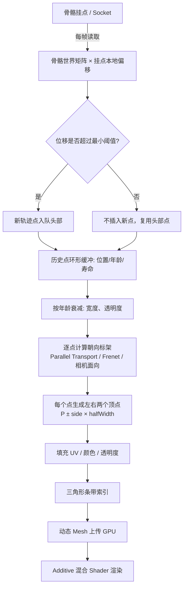

# 3D 渲染中的拖尾刀光（Ribbon Trail / Trail Effect）实现详解

> 适用场景：刀尖刀光、马尾、法杖、刀光剑气、施法轨迹、坐骑尾迹等跟随挂点运动留下的轨迹特效。
> 技术背景：实时 3D 渲染（OpenGL / DirectX / Metal），游戏引擎中常见的 **Ribbon Trail（带状轨迹）** 与 **Particle Trail（粒子轨迹）** 两大类方案；马尾属于另一类 **绳索/布料物理**，文末单独说明。
> 代码示例以 C++ + GLSL 为主，附 Cocos2d-x / Lua 风格的调用层。

---

## 目录

1. [概念辨析：哪些是 Ribbon，哪些不是](#1-概念辨析哪些是-ribbon哪些不是)
2. [总体架构与数据流](#2-总体架构与数据流)
3. [第一步：骨骼挂点世界坐标采样](#3-第一步骨骼挂点世界坐标采样)
4. [第二步：轨迹历史缓冲区（Point Ring Buffer）](#4-第二步轨迹历史缓冲区point-ring-buffer)
5. [第三步：轨迹曲线的朝向帧（标架）——核心难点](#5-第三步轨迹曲线的朝向帧标架核心难点)
6. [第四步：带状网格（Ribbon Mesh）生成](#6-第四步带状网格ribbon-mesh生成)
7. [第五步：Shader 与渲染状态](#7-第五步shader-与渲染状态)
8. [第六步：生命周期、宽度与透明度轮廓](#8-第六步生命周期宽度与透明度轮廓)
9. [各场景变体实现差异对照](#9-各场景变体实现差异对照)
10. [马尾（Ponytail）：不是 Ribbon，是绳索物理](#10-马尾ponytail不是-ribbon是绳索物理)
11. [完整代码示例（C++ / GLSL / Lua）](#11-完整代码示例c--glsl--lua)
12. [常见问题、坑点与性能优化](#12-常见问题坑点与性能优化)
13. [主流引擎内置实现对照](#13-主流引擎内置实现对照)

---

## 1. 概念辨析：哪些是 Ribbon，哪些不是

先把题目里提到的对象分清楚，因为它们在渲染管线里走的是**不同的技术路线**：

| 对象 | 本质 | 主流实现方案 | 说明 |
|---|---|---|---|
| 刀尖刀光（挥砍拖尾） | 一条跟随刀尖走过路径的**发光带状面片** | **Ribbon Trail（动态带状网格）**，通常相机面向 | 高速挥砍时最典型，寿命短、宽度随速度变化 |
| 刀光剑气（斩出的一道光刃） | 一段独立飞行/延展的光带，可弯曲 | Ribbon 或细分面片 + 顶点动画 | 挂点在武器上短暂生成后脱离骨骼独立运动 |
| 法杖施法轨迹 | 法术点/法杖尖走过的曲线光带 | Ribbon Trail，长寿命、颜色渐变 | 常配合粒子辉光叠加 |
| 坐骑尾迹（烟尘、光粒） | 离散粒子的历史位置 | **Particle Trail（粒子拖尾）** 为主 | 地面烟尘用粒子；光带型尾迹才用 Ribbon |
| 马尾 | 随身体摆动的**柔性绳索** | **骨骼链 + 弹簧/Verlet 物理**，网格蒙皮 | 本质是物理模拟，不是轨迹回放（见第 10 节） |

> 一句话总结：**Ribbon Trail 记录的是"挂点过去走过的路径"，把路径织成一条带子；马尾是"挂点被力驱动的实时物理状态"，两者原理完全不同。**

---

## 2. 总体架构与数据流

### 2.1 运行时每帧处理流程



### 2.2 核心思想

Ribbon Trail 的几何非常朴素：

1. 把挂点**每一帧的世界位置**存进一个历史队列（路径点序列）；
2. 把相邻路径点连成一条**空间折线（polyline）**；
3. 在每个路径点上求出一个"侧向向量" `side`，沿 `±side` 各偏移半个宽度，得到左右两个顶点；
4. 相邻两对顶点组成一个四边形（两个三角形），整条轨迹就是一串连续四边形组成的**带状网格（triangle strip）**；
5. 历史点随时间变老、变窄、变透明，最终被移除，带子自然消散。

难点不在"存点"，而在**第 3 步：如何稳定地求出每个点的侧向向量**（朝向帧问题），见第 5 节。

---

## 3. 第一步：骨骼挂点世界坐标采样

### 3.1 挂点（Socket / Attachment）是什么

在带骨骼动画的角色模型里，刀、法杖、马尾、武器都挂在某根骨骼（Bone）上。挂点是骨骼局部坐标系下的一个固定偏移点，例如：

- 刀尖：`bone = "Weapon_Blade_Tip"`，本地偏移 `(0, bladeLength, 0)`；
- 法杖尖：`bone = "Staff_Tip"`；
- 马尾根部：`bone = "Hair_Root"`。

### 3.2 每帧取世界坐标

骨骼在动画求值（蒙皮前）已经给出该骨骼的**世界变换矩阵** `boneWorld`。挂点世界坐标：

```
worldPos = boneWorld * localOffset
```

数学形式（列向量、列主序矩阵）：

```
P_world = M_bone · P_local
```

其中 `M_bone` 包含骨骼的平移、旋转、缩放；`P_local` 是挂点在骨骼局部空间的偏移。

### 3.3 采样策略（容易被忽略的细节）

| 策略 | 做法 | 目的 |
|---|---|---|
| 位移阈值 | 本帧 `worldPos` 与上一帧头部点距离小于 `minDist` 时，不新增点，只更新头部点 | 角色静止时避免历史队列里堆出一堆重合点，防止带子抖动、UV 挤在一起 |
| 时间窗口 | 轨迹只保留最近 `lifeTime` 秒内的点 | 控制拖尾长度 |
| 固定点数 | 队列最多 `maxPoints` 个，超出丢弃最老点 | 控制顶点预算 |
| 子步采样（可选） | 一帧内按时间插值补点 | 高帧率下点过密、低帧率下点过疏；高速运动时保证折线平滑 |

> 注意：挂点坐标必须在**骨骼动画求值之后、蒙皮渲染之前**读取。引擎里通常挂在骨骼更新回调（`onBoneTransform` / 动画事件）之后。

---

## 4. 第二步：轨迹历史缓冲区（Point Ring Buffer）

### 4.1 轨迹点数据结构

每个历史点保存：

```cpp
struct TrailPoint {
    Vec3  position;      // 世界坐标
    float age;           // 已存活时间（秒）
    float lifeTime;      // 总寿命（秒），到期移除
    float widthScale;    // 该点宽度系数（由轮廓曲线给出）
    Vec3  side;          // 该点的侧向向量（第 5 节算出，缓存避免重复计算）
    float alpha;         // 该点透明度（由轮廓曲线给出）
};
```

### 4.2 缓冲区组织

- **环形缓冲（ring buffer）** 或 `std::deque` / `std::vector` 头部插入、尾部弹出；
- 头部（最新点）跟随挂点；尾部（最老点）逐渐消散；
- 每帧更新：

```cpp
// 伪代码：每帧更新所有历史点
for (auto& p : points) {
    p.age += dt;
    if (p.age >= p.lifeTime) p.dead = true;
}
// 移除尾部死亡点
while (!points.empty() && points.front().dead) points.pop_front();
```

### 4.3 两种寿命控制方式

| 方式 | 描述 | 适用 |
|---|---|---|
| 固定时间长度 | 每个点寿命 `lifeTime` 固定（如 0.35s），拖尾长度由运动速度 × 时间决定 | 刀光、剑气、施法轨迹 |
| 固定点数 | 队列长度恒定，新点挤掉最老点 | 对顶点数预算要求严格的移动端 |

实际项目里常把两者结合：**点数上限 + 时间寿命双约束**。

---

## 5. 第三步：轨迹曲线的朝向帧（标架）——核心难点

### 5.1 问题描述

轨迹是一条空间曲线，我们要在每个点 `P_i` 上构造一个**局部坐标系（标架）**，从中取出"侧向向量" `side_i`，把带子向 `side_i` 两侧撑开。标架由三个正交向量构成：

- **切线 T（tangent）**：沿轨迹前进方向；
- **法线 N（normal）**：在曲线所在平面内指向弯曲方向；
- **副法线 B（binormal）**：`B = T × N`，带子的横向（撑开方向）。

带子的两个顶点位置：

```
V_left  = P_i - side_i · halfWidth_i
V_right = P_i + side_i · halfWidth_i
```

`side_i` 就是 `B_i`（或经过相机投影修正后的横向向量）。**标架求不稳，带子就会翻转、撕裂、拧成麻花。**

### 5.2 方案一：Frenet–Serret 标架（教科书方案）

对参数曲线 `C(s)`，取相邻点差分得到切线：

```
T_i = normalize( P_{i+1} - P_{i-1} )
```

曲率法线：

```
N_i = normalize( dT/ds )
```

副法线：

```
B_i = T_i × N_i
```

数学上 Frenet 标架光滑正交，但在**游戏实时轨迹**里有两个致命问题：

1. **曲率为零（直线段）时 N 退化**：`dT/ds ≈ 0`，归一化得到零向量；
2. **拐点处法线瞬间翻转 180°**：曲线弯曲方向反转时，N 突然跳变，导致带子瞬间翻面、闪烁撕裂。

所以 Frenet 只适合曲率连续、无拐点的平滑曲线，**不适合直接做挥砍刀光**。

### 5.3 方案二：Parallel Transport Frame（平行传输标架，工业界主流）

**核心思想**：不每帧重新求 N，而是把上一个点的标架"旋转"到当前点，只跟随切线方向的变化做最小旋转，避免法线突然翻转。

#### 递推步骤

1. 头部第 0 个点：手动给定一个初始参考方向（角色上向量或相机方向），构造初始标架；
2. 从点 `i-1` 到点 `i`，切线从 `T_{i-1}` 变到 `T_i`，两者之间存在一个旋转轴：

```
axis = T_{i-1} × T_i
```

旋转角：

```
θ = arccos( T_{i-1} · T_i )
```

3. 把上一点的法线 `N_{i-1}` 绕 `axis` 旋转 `θ`，得到 `N_i`；再把 `N_i` 投影到垂直于 `T_i` 的平面上（消除数值漂移）：

```
N_i = N_{i-1} - T_i · (T_i · N_{i-1})
N_i = normalize(N_i)
B_i = T_i × N_i
```

这样法线只随切线的缓慢变化而平行移动，**不会在拐点处跳变**，带状表面不会拧转。

> Unity `TrailRenderer`、Unreal 带状粒子、多数自研刀光特效底层用的都是这类平行传输/最小旋转标架。

### 5.4 方案三：相机面向（Camera-facing Ribbon，刀光最常用）

另一种更简单、视觉效果最稳的方案：**带子始终面向相机**，完全不依赖曲线自己的 N/B 标架。

对每个路径点 `P_i`：

```
T_i = normalize(P_{i+1} - P_{i-1})          // 轨迹切线
toCam = normalize(cameraPos - P_i)          // 指向相机
side_i = normalize( T_i × toCam )           // 横向：切线与视线叉乘
```

- `side_i` 同时垂直于轨迹方向和视线方向；
- 带子永远平铺在"切线 + 视线"平面内，从任意角度看都是一条亮带；
- 没有拐点翻转问题，实现最简单，**挥砍刀光、剑气、施法轨迹 90% 用这种**。

缺点：轨迹在不同观察角度下宽度视觉会有变化；当 `T_i` 与 `toCam` 接近平行时叉乘退化（轨迹正对镜头），需要给 `side` 一个兜底方向。

### 5.5 方案四：参考方向投影法（Fixed Reference）

给定一个世界上向量 `up = (0,1,0)`：

```
side_i = normalize( up × T_i )
```

再把 `side_i` 投影回垂直 `T_i` 的平面。适合大体朝一个平面运动的尾迹（如地面坐骑光尾、水平挥砍），但轨迹竖直时 `up` 与切线平行会退化。

### 5.6 方案选型对照

| 方案 | 稳定性 | 复杂度 | 典型用途 |
|---|---|---|---|
| Frenet 标架 | 差（拐点翻转、直线退化） | 低 | 仅理论教学、平滑曲线 |
| Parallel Transport | 好 | 中 | 要求三维空间朝向的 ribbon（环绕身体的光带、长施法曲线） |
| Camera-facing | 很好 | 低 | 刀光、剑气、施法轨迹、短拖尾（最常用） |
| 固定参考方向投影 | 一般 | 很低 | 平面运动的地面尾迹 |

---

## 6. 第四步：带状网格（Ribbon Mesh）生成

### 6.1 顶点结构

```cpp
struct RibbonVertex {
    Vec3  position;   // 世界坐标
    Vec2  uv;         // u: 沿轨迹 0(尾)→1(头)，v: 横跨 0→1
    Vec4  color;      // RGB 颜色，A 透明度
    // 视引擎需要可加：tangent、normal、width 等
};
```

### 6.2 顶点与索引布局

历史点按 `points[0]`（最老/尾） → `points[N-1]`（最新/头）排列。每个点输出左右两个顶点：

```
对第 i 个点：
    halfW = width_i * 0.5
    leftPos  = P_i - side_i * halfW
    rightPos = P_i + side_i * halfW

    uvLeft  = (u_i, 0)
    uvRight = (u_i, 1)
```

索引构成三角形条带（相邻两对顶点组成四边形）：

```
(i, i+1) 段两个三角形：
    (L_i, R_i, L_{i+1})
    (R_i, R_{i+1}, L_{i+1})
```

### 6.3 UV 坐标约定

- `u` 沿轨迹方向：尾部 `u=0`，头部 `u=1`（或反过来，按纹理方向定）；
- `v` 横跨带子：左 `v=0`，右 `v=1`；
- 纹理横向一张刀光图，`v` 方向通常是光带的明暗截面（中间亮、两边暗）；
- 想做流光滚动：在 Shader 里对 `u` 或 `v` 加 `time * speed` 偏移。

### 6.4 宽度轮廓（Shape Profile）

刀光不是等宽长条，一般沿轨迹有形状曲线。以点在轨迹上的归一化位置 `t = age / lifeTime`（`t=0` 刚出生，`t=1` 消失）为例：

- 根部（头部，刚从刀尖出来）较宽；
- 中段最宽或带波浪；
- 尾部收窄成尖。

宽度系数可以用一条曲线资产（animation curve）或简单公式给出：

```
widthScale(t) = (1 - t) * (headWidthBoost)
// 或分段：t<0.2 扩宽，之后线性收窄
```

### 6.5 与"速度挂钩"的宽度

挥砍刀光的亮度/宽度常跟随刀尖瞬时速度：

```
speed = length(P_current - P_last) / dt
width = baseWidth * clamp(speed / referenceSpeed, minW, maxW)
```

挥得快 → 刀光宽且亮；静止 → 窄、暗、快速消散。

---

## 7. 第五步：Shader 与渲染状态

### 7.1 渲染状态（固定管线/状态机层面）

刀光、剑气、魔法轨迹都是**发光叠加**类特效，典型状态：

| 状态 | 设置 | 原因 |
|---|---|---|
| 混合模式 | `SRC_ALPHA, ONE`（加法混合 AdditiveBlending） | 光色互相叠加变亮，符合发光视觉 |
| 深度写入 | `DepthWrite = Off` | 透明特效不写深度，避免互相遮挡出错 |
| 深度测试 | `DepthTest = On`（按需求可关闭穿透） | 保证被墙体/角色正确遮挡 |
| 背面剔除 | `Cull = Off`（双面渲染） | 相机绕到背面时带子不消失 |
| 排序 | 按特效层级，避免在不透明物体中间穿插 | 加法混合本身顺序不敏感，减少排序开销 |

### 7.2 顶点 Shader（GLSL ES 3.0 风格）

```glsl
// ribbon.vert
uniform mat4 u_MVP;                 // 模型-视图-投影矩阵（此处几何已在世界空间）

layout(location = 0) in vec3  a_position;
layout(location = 1) in vec2  a_uv;
layout(location = 2) in vec4  a_color;

out vec2  v_uv;
out vec4  v_color;

void main()
{
    v_uv    = a_uv;
    v_color = a_color;
    gl_Position = u_MVP * vec4(a_position, 1.0);
}
```

### 7.3 片元 Shader：纹理 + 渐隐 + 流光

```glsl
// ribbon.frag
precision mediump float;

uniform sampler2D u_texture;        // 刀光/轨迹贴图（v 方向明暗截面）
uniform float     u_scrollSpeed;    // 纹理滚动速度（沿 u 方向）
uniform float     u_time;           // 全局时间
uniform vec4      u_colorHead;      // 头部颜色
uniform vec4      u_colorTail;      // 尾部颜色

in vec2  v_uv;
in vec4  v_color;
out vec4 fragColor;

void main()
{
    // 1) 沿轨迹方向滚动纹理，形成流光扫过的感觉
    vec2 uv = v_uv;
    uv.x = fract(uv.x - u_time * u_scrollSpeed);

    // 2) 采样贴图，取贴图亮度作为光强
    vec4 tex = texture(u_texture, uv);

    // 3) 头/尾颜色渐变：v_color.a 已由 CPU 按年龄写入，这里再叠加颜色沿 u 的渐变
    float uT = v_uv.x;                          // 0 尾 → 1 头
    vec3 col = mix(u_colorTail.rgb, u_colorHead.rgb, uT);

    // 4) 透明度：点年龄衰减 × 贴图 alpha × 颜色渐变
    float alpha = v_color.a * tex.a;

    // 5) 加法混合下输出：颜色 * alpha（片元颜色预乘 alpha）
    fragColor = vec4(col * tex.rgb * alpha, alpha);
}
```

### 7.4 刀光常见增强手法

1. **多层叠加**：同一条轨迹用 2~3 层不同颜色、宽度、贴图的 ribbon 叠在一起（外层光晕宽而淡，内层核心亮而窄）；
2. **截面锐化**：贴图 `v` 方向画成中间一条亮线、两边快速衰减，形成刀锋锐利感；
3. **噪声扰动**：片元里叠加一个时间驱动的噪声偏移 `uv += noise(...) * amount`，让边缘颤动；
4. **边缘发光**：按 `|v - 0.5|` 距离计算二次发光；
5. **颜色脉冲**：头部亮度随挥砍节奏或时间脉动。

---

## 8. 第六步：生命周期、宽度与透明度轮廓

### 8.1 衰减曲线

每个点的归一化寿命 `t = age / lifeTime ∈ [0, 1]`，由 `t` 驱动两条曲线：

- **透明度曲线**：`alpha(t) = (1 - t)^k`，`k > 1` 时尾部消散更快；
- **宽度曲线**：`widthScale(t) = (1 - t) * shapeCurve(t)`。

常见形状（刀光）：

```
alpha
 1 |   ●●
   |  /   \
   | /      ●●●
 0 +------------ t
   0            1

width
   |        ●●●
   |       /   \
   |      /     ●●
   |  ●●/
 0 +------------ t
   0            1
```

### 8.2 发射/停止机制

- **触发式**（挥砍）：动作开始（攻击事件）开启发射，动作结束后停止插入新点，存量轨迹自然消散；
- **持续式**（跑动尾迹、常驻施法光带）：一直采样，点持续老化循环；
- **速度门控**：挂点速度低于阈值时不插入新点，避免静止时残留一段不会动的"死带子"。

---

## 9. 各场景变体实现差异对照

| 场景 | 挂点 | 寿命 | 标架方案 | 宽度/形状要点 | 附加处理 |
|---|---|---|---|---|---|
| 刀尖刀光 | 武器末端骨骼 | 0.2~0.5s，短 | 相机面向为主 | 宽度随挥砍速度，头部宽、尾收尖 | 多层叠加、亮核+光晕、速度门控 |
| 剑气（飞出光刃） | 生成后脱离挂点，自带飞行轨迹 | 0.5~1.5s | 相机面向或平行传输 | 长条形、两端略收，可中途弯曲 | 独立刚体/曲线运动、命中后爆裂粒子 |
| 法杖施法轨迹 | 法杖尖 / 法术目标点 | 0.5~2s | 平行传输（绕身环绕曲线需要稳定三维朝向） | 细窄光带，颜色沿轨迹渐变 | 端点辉光粒子、颜色随施法阶段变化 |
| 坐骑尾迹（光带） | 坐骑尾部/脚部 | 跟随移动，循环 | 相机面向 | 贴地方向、宽而淡 | 常与地面投影、扬尘粒子配合 |
| 坐骑烟尘尾迹 | 脚部多个挂点 | 短寿命粒子 | 粒子 Billboard | 离散粒子大小/透明度衰减 | 重力、扩散、风吹扰动 |

### 9.1 刀尖刀光的典型参数（参考量级，需按美术调）

| 参数 | 参考值 |
|---|---|
| 轨迹寿命 | 0.25 ~ 0.45 s |
| 最大点数 | 32 ~ 64（每点 2 顶点） |
| 基础宽度 | 0.15 ~ 0.4 米（角色尺度下） |
| 最小采样位移 | 0.01 ~ 0.03 米 |
| 混合模式 | 加法混合，双面，不写深度 |

### 9.2 施法轨迹与刀光的区别

- 刀光**跟随瞬时动作**，动作结束即停；施法轨迹常**持续存在**并沿预设路径延展；
- 刀光不需要稳定三维标架（面向相机即可）；环绕角色、螺旋上升的魔法轨迹必须用 **Parallel Transport**，否则相机面向方案在环绕时会反复翻转朝向。

---

## 10. 马尾（Ponytail）：不是 Ribbon，是绳索物理

### 10.1 本质区别

- Ribbon：**回放历史路径**，点是"过去的挂点位置"，几何由历史队列生成；
- 马尾：**实时模拟柔性绳索**，每根发束节点被重力、惯性、阻尼和约束驱动，跟随身体一起运动，最终用一段骨骼链或网格蒙皮渲染出来。

### 10.2 常见物理方案

#### 方案 A：弹簧阻尼骨骼链（最常用，性能好）

马尾由一串骨骼 `HairBone[0..N]` 组成，根部绑定在头部骨骼。每根骨骼末端挂一个弹簧/阻尼子节点：

```
加速度：
    a = g * gravityDir + windForce - k * (p - restPos) - c * v
积分（半隐式欧拉）：
    v += a * dt
    p += v * dt
约束：长度不变（每段骨骼保持固定长度）
```

- 随角色转身、加速、急停时，发束因惯性滞后甩动；
- 工程上常用**两级骨骼**：一根主骨骼做主摆动，一根子骨骼做二级晃动，开销极低。

#### 方案 B：Verlet 绳索（更软、更自然）

节点位置直接积分（不显式存速度）：

```cpp
// Verlet 积分
Vec3 prev = node.prevPos;
Vec3 cur  = node.pos;
Vec3 next = cur + (cur - prev) * damping + gravity * dt * dt;
node.prevPos = cur;
node.pos = next;
// 迭代距离约束：相邻节点距离恒等于 restLength
```

适合发辫、布片、飘带等需要柔和形变的对象。

#### 方案 C：布料/蒙皮网格

要求精细发丝时用网格 + 简化布料模拟；手游一般不用，成本高。

### 10.3 马尾与身体运动的配合

- 跟随父骨骼的**加速度**而非位置：角色急停时马尾继续前甩；角色转身时滞后摆动；
- 碰撞简化：只对头部、躯干、武器做球体/胶囊体碰撞检测，防止穿模；
- 渲染：马尾网格绑定到这条骨骼链上做蒙皮，不需要历史轨迹缓冲。

### 10.4 什么时候马尾上还会叠 Ribbon？

高级表现里，马尾发梢可以**额外挂一个短寿命 Ribbon 拖尾**（发丝残影/光丝），此时马尾本体走物理，发梢轨迹走第 2~8 节的 Ribbon 流程，两者叠加。

---

## 11. 完整代码示例（C++ / GLSL / Lua）

### 11.1 轨迹点与 Ribbon 类骨架（C++，带注释）

```cpp
#include <vector>
#include <deque>
#include "Math/Vec3.h"

// 单条轨迹点
struct TrailPoint
{
    Vec3  position;      // 世界坐标
    Vec3  side;          // 该点侧向向量（缓存，避免每帧重算）
    float age;           // 已存活时间
    float lifeTime;      // 总寿命
    float widthScale;    // 宽度系数
    float alpha;         // 透明度
};

class RibbonTrail
{
public:
    // ---- 可调参数 ----
    float lifeTime      = 0.35f;   // 轨迹总寿命（秒）
    float baseWidth     = 0.25f;   // 基础宽度（世界单位）
    float minSampleDist = 0.015f;  // 最小采样位移，小于则不新增点
    int   maxPoints     = 48;      // 历史点上限

    Vec3  refCameraPos;            // 当前相机位置（由外部每帧灌入）

    std::deque<TrailPoint> points; // 头部=最新，尾部=最老

public:
    // 每帧由骨骼挂点世界坐标驱动
    void Update(const Vec3& worldAnchor, float dt)
    {
        // 1) 更新所有存活点年龄，移除超龄尾部点
        for (auto& p : points) p.age += dt;
        while (!points.empty() && points.front().age >= points.front().lifeTime)
            points.pop_front();

        // 2) 与头部点距离不足阈值：只刷新头部点位置，不新增（防抖动）
        if (!points.empty())
        {
            TrailPoint& head = points.back();
            if (Vec3::Distance(head.position, worldAnchor) < minSampleDist)
            {
                head.position = worldAnchor;
                head.age = 0.0f; // 头部继续存活
                return;
            }
        }

        // 3) 插入新点到头部
        TrailPoint np;
        np.position  = worldAnchor;
        np.age       = 0.0f;
        np.lifeTime  = lifeTime;
        points.push_back(np);

        // 4) 超出点数上限，丢弃最老点
        if ((int)points.size() > maxPoints)
            points.pop_front();
    }

    // 计算所有点的侧向向量（相机面向方案）
    void ComputeSides()
    {
        const int n = (int)points.size();
        if (n == 0) return;

        for (int i = 0; i < n; ++i)
        {
            Vec3 pPrev = points[std::max(i - 1, 0)].position;
            Vec3 pNext = points[std::min(i + 1, n - 1)].position;

            // 切线：前后点差分
            Vec3 tangent = pNext - pPrev;
            if (tangent.LengthSq() < 1e-8f) tangent = Vec3(0, 1, 0);
            tangent.Normalize();

            // 视线方向：指向相机
            Vec3 toCam = refCameraPos - points[i].position;
            toCam.Normalize();

            // side = tangent × toCam，再归一化
            Vec3 side = Vec3::Cross(tangent, toCam);
            if (side.LengthSq() < 1e-8f)
            {
                // 退化兜底：切线与视线平行时，用世界上向量叉出一个方向
                side = Vec3::Cross(tangent, Vec3(0, 1, 0));
            }
            side.Normalize();
            points[i].side = side;

            // 由寿命归一化 t 计算宽度与透明度轮廓
            float t = points[i].age / points[i].lifeTime; // 0 新 → 1 老
            points[i].widthScale = WidthProfile(t);
            points[i].alpha      = AlphaProfile(t);
        }
    }

    // 宽度轮廓：刚生成略窄，中段舒展，尾部收尖
    static float WidthProfile(float t)
    {
        // t ∈ [0,1]；此处给一个可替换为动画曲线的公式
        if (t < 0.15f) return 0.6f + (t / 0.15f) * 0.4f; // 头部起步扩宽
        return 1.0f - (t - 0.15f) / 0.85f;              // 之后线性收窄
    }

    // 透明度轮廓：平方衰减，尾部快速消散
    static float AlphaProfile(float t)
    {
        float remain = 1.0f - t;
        return remain * remain;
    }
};
```

### 11.2 网格填充（顶点 / 索引组装）

```cpp
void BuildMesh(const RibbonTrail& trail,
               std::vector<RibbonVertex>& outVerts,
               std::vector<uint16_t>& outIndices)
{
    outVerts.clear();
    outIndices.clear();
    const int n = (int)trail.points.size();
    if (n < 2) return;

    // 每个点输出左右两个顶点
    for (int i = 0; i < n; ++i)
    {
        const TrailPoint& p = trail.points[i];
        float halfW = trail.baseWidth * p.widthScale * 0.5f;

        Vec3 left  = p.position - p.side * halfW;
        Vec3 right = p.position + p.side * halfW;

        // u：沿轨迹 尾(0) → 头(1)
        float u = (float)i / (n - 1);

        outVerts.push_back({ left,  Vec2(u, 0.0f), Vec4(1,1,1, p.alpha) });
        outVerts.push_back({ right, Vec2(u, 1.0f), Vec4(1,1,1, p.alpha) });
    }

    // 三角形条带索引：相邻两对顶点组成四边形
    for (int i = 0; i < n - 1; ++i)
    {
        uint16_t L0 = (uint16_t)(i * 2);
        uint16_t R0 = (uint16_t)(i * 2 + 1);
        uint16_t L1 = (uint16_t)((i + 1) * 2);
        uint16_t R1 = (uint16_t)((i + 1) * 2 + 1);

        outIndices.push_back(L0); outIndices.push_back(R0); outIndices.push_back(L1);
        outIndices.push_back(R0); outIndices.push_back(R1); outIndices.push_back(L1);
    }
}
```

### 11.3 平行传输标架（Parallel Transport）版本替换 `ComputeSides`

当轨迹需要在三维空间稳定缠绕（魔法环绕光带）时，用下面的递推替代相机面向方案：

```cpp
void ComputeSidesParallelTransport(RibbonTrail& trail)
{
    auto& pts = trail.points;
    const int n = (int)pts.size();
    if (n == 0) return;

    // 1) 首点：切线 + 给定参考上向量构造初始标架
    Vec3 T0 = (n > 1) ? (pts[1].position - pts[0].position) : Vec3(0,1,0);
    T0.Normalize();
    Vec3 N0 = Vec3::Cross(Vec3(0,1,0), T0);
    if (N0.LengthSq() < 1e-8f) N0 = Vec3::Cross(Vec3(1,0,0), T0); // 退化兜底
    N0.Normalize();

    Vec3 prevT = T0;
    Vec3 prevN = N0;

    for (int i = 0; i < n; ++i)
    {
        Vec3 pPrev = pts[std::max(i - 1, 0)].position;
        Vec3 pNext = pts[std::min(i + 1, n - 1)].position;
        Vec3 T = pNext - pPrev;
        if (T.LengthSq() < 1e-8f) T = prevT;
        T.Normalize();

        if (i > 0)
        {
            // 由 prevT → T 的最小旋转，把 prevN 搬到当前点
            Vec3 axis = Vec3::Cross(prevT, T);
            float axisLen = axis.Length();
            if (axisLen > 1e-6f)
            {
                axis.Normalize();
                float cosAng = Vec3::Dot(prevT, T);
                cosAng = std::max(-1.0f, std::min(1.0f, cosAng));
                float ang = std::acos(cosAng);
                prevN = prevN.RotateAroundAxis(axis, ang); // 四元数/轴角旋转
            }
            // 投影到垂直 T 的平面，消除数值漂移并归一化
            prevN = prevN - T * Vec3::Dot(prevN, T);
            prevN.Normalize();
        }

        Vec3 B = Vec3::Cross(T, prevN); // 副法线 = 带子横向
        pts[i].side = B;
        prevT = T;
    }
}
```

### 11.4 Cocos2d-x / Lua 风格调用层示例

```lua
-- 每个刀光特效挂在攻击骨骼挂点上
local trail = cc.Node:create()
-- 绑定自定义 RibbonTrail 组件（C++ 导出到 Lua）
trail:addComponent("RibbonTrail")
trail:getComponent("RibbonTrail"):setLifeTime(0.35)
trail:getComponent("RibbonTrail"):setBaseWidth(0.25)
trail:getComponent("RibbonTrail"):setMaxPoints(48)

-- 骨骼挂点：动画更新后取刀尖世界坐标
function onFrame(dt)
    local bone = self.skeleton:getBone("Weapon_Blade_Tip")
    local worldPos = bone:getWorldPosition() -- 骨骼矩阵 × 挂点本地偏移
    trail:getComponent("RibbonTrail"):update(worldPos, dt)
end

-- 攻击动作开始：开启发射；动作结束：停止采样，等待残留消散
function onAttackStart()
    trail:getComponent("RibbonTrail"):setEmitting(true)
end
function onAttackEnd()
    trail:getComponent("RibbonTrail"):setEmitting(false)
end
```

---

## 12. 常见问题、坑点与性能优化

### 12.1 视觉问题排查表

| 现象 | 可能原因 | 解决方向 |
|---|---|---|
| 带子中途翻转、拧麻花 | 用了 Frenet 标架；拐点法线跳变 | 换相机面向方案或 Parallel Transport |
| 静止时刀光抖动、冒出褶皱 | 采样阈值过小，重合点堆叠 | 增大 `minSampleDist`，距离不足只更新头部点 |
| 正对镜头时带子消失/变细 | 切线与视线平行，叉乘退化 | 加兜底参考方向；退化时沿 `up × T` 取 side |
| 刀光把后面的角色/地面挡住 | 深度写入未关闭 | `DepthWrite = Off`；检查排序与层级 |
| 多条刀光互相穿插、颜色错乱 | 加法混合下透明排序错误 | 同一特效层级内批量渲染；关闭深度写入；必要时按距离分组 |
| 尾部锯齿/撕裂 | 点数不足、三角形跨度过大 | 提高采样频率、增加点数；宽度轮廓尾部提前收窄 |
| 高速挥砍轨迹断续 | 帧率低时一帧位移过大、折线粗糙 | 帧内子步插值补点；或降低 `minSampleDist` |
| 边缘发灰、发脏 | 贴图 alpha 通道不干净；非加法混合残留底色 | 检查贴图 alpha；确认混合函数 `SRC_ALPHA, ONE` |

### 12.2 性能优化要点

1. **顶点预算固定**：`maxPoints` 封顶，顶点数 = `maxPoints × 2`，索引 = `(maxPoints-1) × 6`，移动端控制在几十点级别；
2. **复用动态 Mesh**：不要每帧 `new/delete` 顶点缓冲，使用环形动态 VBO（`DYNAMIC_DRAW`），每帧 `glBufferSubData` 局部更新；
3. **合并同类特效**：同屏多条刀光在同一个 Draw Call 里批量提交；
4. **标架计算只在 CPU 做一次**：`side` 存入历史点缓存，网格填充时直接复用，避免每帧重复叉乘；
5. **关闭背面剔除**换取简单；若想省片元，可做单面 + 朝向判断（多数情况下双面成本可接受）；
6. **生命周期与对象池**：刀光特效频繁创建销毁，用对象池复用 `RibbonTrail` 实例和 Mesh 缓冲；
7. **低分辨率粒子替代**：移动端性能紧张时，可用一串 `Billboard` 粒子沿路径排布近似刀光，减少带状网格开销。

### 12.3 精度与坐标空间注意事项

- 历史点存**世界坐标**，避免模型空间下骨骼变换导致坐标错乱；
- 大场景坐标系下注意浮点精度，长时间运行不要累积误差；
- 挂点本地偏移要随骨骼缩放处理均匀（非等比缩放下宽度需要补偿）。

---

## 13. 主流引擎内置实现对照

| 引擎 | 组件 | 底层方案 | 备注 |
|---|---|---|---|
| Unity | `TrailRenderer` | 相机/速度方向带状网格，历史点队列，支持宽度曲线、颜色渐变 | 与本文 Camera-facing Ribbon 思路一致 |
| Unreal | Ribbon Particle（`Trail` 模块 / Niagara Ribbon） | Ribbon 粒子模块，历史粒子连线成带，支持 Parallel Transport 取向 | 可选择对齐方式：视角、速度、法线 |
| Cocos2d-x / 自研 | 无内置成熟组件，需自定义 Mesh | 本文方案：环形缓冲 + 动态 VBO + 自定义 Shader | 挂点取骨骼世界矩阵变换 |
| 手游自研框架 | 通常封装 `TrailEffect` 组件 | 相机面向 Ribbon + 对象池，参数曲线配置化 | 美术通过曲线资源调宽度/透明度 |

---

## 附：Ribbon Trail 实现最小闭环清单

- [ ] 骨骼挂点每帧输出世界坐标；
- [ ] 位移阈值 + 时间寿命 + 点数上限三重历史点管理；
- [ ] 选定标架方案（刀光首选相机面向，环绕曲线用 Parallel Transport）；
- [ ] 每点左右双顶点 + 三角形条带索引；
- [ ] UV 沿轨迹/横跨映射，贴图滚动流光；
- [ ] 宽度、透明度随年龄衰减的轮廓曲线；
- [ ] 加法混合、双面、关闭深度写入；
- [ ] 对象池 + 动态 VBO 复用，避免每帧分配；
- [ ] 速度门控：静止不发射，挥砍速度联动宽度亮度。
